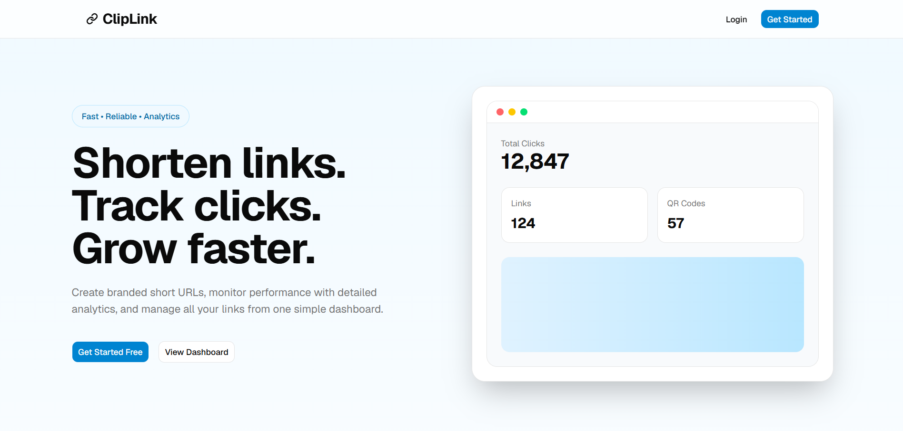
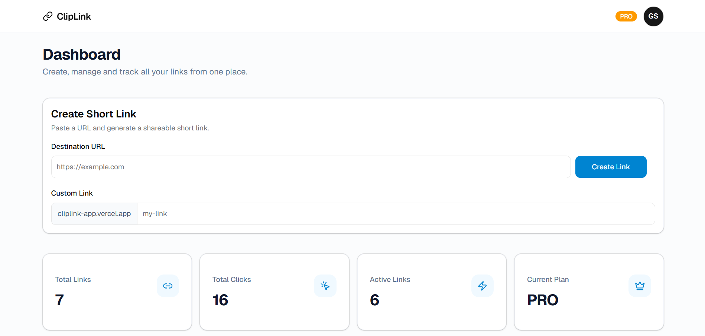
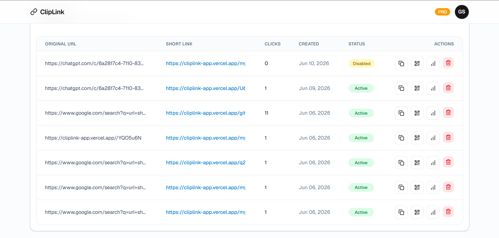
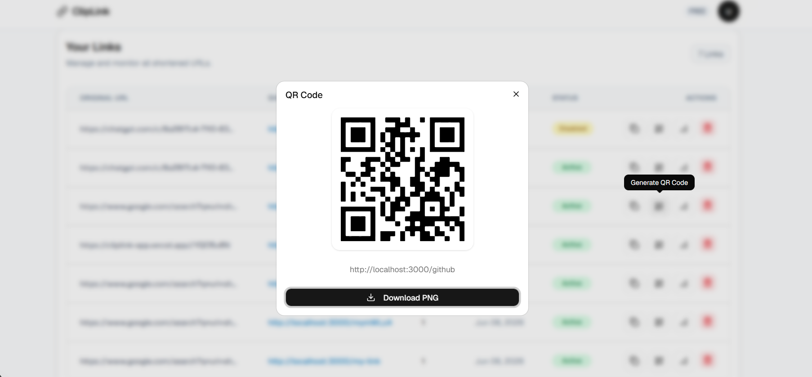
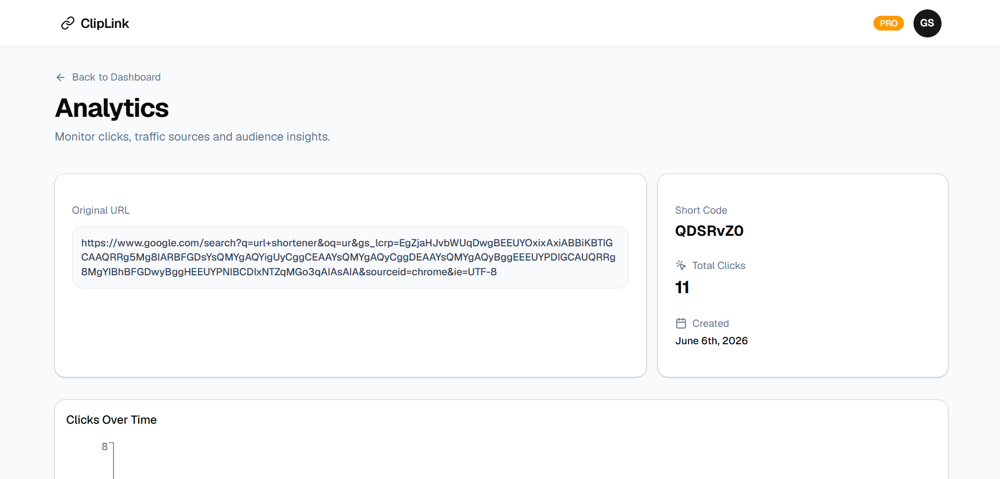
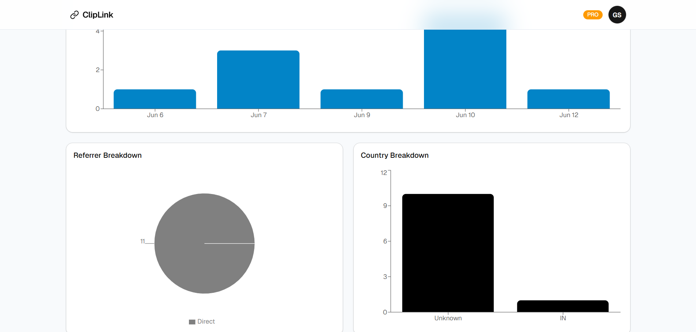
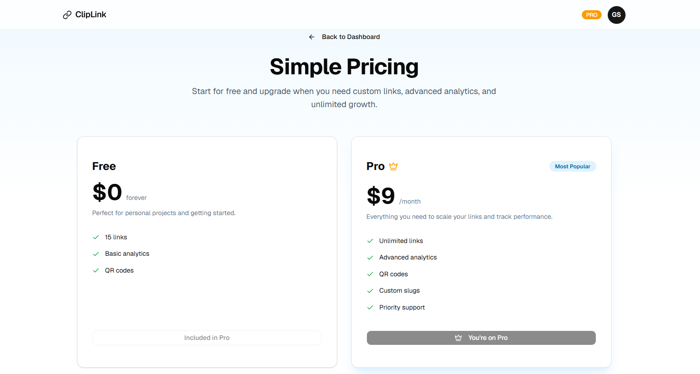

# ClipLink — URL Shortener

A full-stack URL shortener built with Next.js 16, TypeScript, and PostgreSQL. Create short links, track clicks with analytics, generate QR codes, and upgrade to Pro through a Razorpay checkout with server-side signature verification.

**Live Demo → [cliplink-app.vercel.app](https://cliplink-app.vercel.app)**

> Payments run in Razorpay **test mode**, so no real money is charged. See [Testing the payment flow](#testing-the-payment-flow) for test credentials.

---

## Tech Stack


| Category      | Technology                                       |
| ------------- | ------------------------------------------------ |
| Framework     | Next.js 16 (App Router)                          |
| Language      | TypeScript                                       |
| Styling       | Tailwind CSS + shadcn/ui                         |
| Auth          | Better Auth (email/password + Google & GitHub)   |
| Database      | Prisma 6 + Neon PostgreSQL                       |
| Payments      | Razorpay (Orders API, Checkout, Webhooks) — test mode |
| Server State  | TanStack Query + Axios                           |
| Charts        | Recharts                                         |
| Rate Limiting | Upstash Redis (sliding window)                   |
| Forms         | React Hook Form + Zod                            |
| QR Codes      | react-qr-code                                    |
| Deployment    | Vercel                                           |

---

## Screenshots

 
 
 


---

## Features

- **URL Shortening** — Paste any http(s) URL and get a clean short link instantly
- **Custom Slugs** — Pro users can create branded links like `cliplink.com/my-portfolio`
- **Click Analytics** — Track clicks over time, referrer sources, and country breakdown with interactive charts
- **QR Code Generation** — Generate and download a PNG QR code for every link
- **Link Controls** — Enable or disable any link; expired links stop redirecting
- **Free / Pro Tiers** — Free users get 15 links. Pro users get unlimited links and custom slugs
- **Razorpay Payments** — One-time Pro upgrade with server-created orders, HMAC signature verification, and an idempotent webhook
- **Rate Limiting** — Protects link creation, redirects, and payment attempts from abuse
- **Auth** — Email/password + OAuth login (Google & GitHub) with secure httpOnly sessions

---

## Project Structure

```
src/
├── app/
│   ├── (auth)/                 # Login and signup pages
│   ├── (protected)/            # Dashboard and pricing pages
│   ├── [slug]/route.ts         # Redirect engine (Route Handler)
│   └── api/
│       ├── auth/               # Better Auth handler
│       ├── links/              # Link CRUD endpoints
│       ├── payments/           # create-order and verify endpoints
│       └── razorpay/webhook/   # Razorpay webhook receiver
├── components/
│   ├── landing/                # Landing page sections
│   ├── shared/                 # Reusable components
│   └── ui/                     # shadcn/ui components
├── hooks/                      # TanStack Query hooks
├── lib/                        # auth, prisma, ratelimit, razorpay, payments, slug, client-ip, constants
├── schemas/                    # Zod validation schemas
└── proxy.ts                    # Optimistic auth redirects (Next.js 16 proxy)
```

---

## Getting Started

### Prerequisites

- Node.js 18+
- A [Neon](https://neon.tech) PostgreSQL database
- An [Upstash](https://upstash.com) Redis database
- A [Razorpay](https://razorpay.com) account (test mode is free)

### Installation

**1. Clone the repository**

```bash
git clone https://github.com/gurwindersingh777/cliplink.git
cd cliplink
```

**2. Install dependencies**

```bash
npm install
```

**3. Set up environment variables**

Copy `.env.example` to `.env` and fill in your values:

```bash
cp .env.example .env
```

```env
DATABASE_URL=                 # Neon pooled connection string
DIRECT_URL=                   # Neon direct (non-pooled) connection string, used by Prisma Migrate
BETTER_AUTH_SECRET=
BETTER_AUTH_URL=http://localhost:3000
NEXT_PUBLIC_APP_URL=http://localhost:3000
UPSTASH_REDIS_REST_URL=
UPSTASH_REDIS_REST_TOKEN=
GOOGLE_CLIENT_ID=
GOOGLE_CLIENT_SECRET=
GITHUB_CLIENT_ID=
GITHUB_CLIENT_SECRET=
RAZORPAY_KEY_ID=              # Test key (rzp_test_...)
RAZORPAY_KEY_SECRET=
RAZORPAY_WEBHOOK_SECRET=      # Any random string; must match the secret on the webhook in the Razorpay dashboard
```

**4. Run database migrations**

```bash
npx prisma migrate dev
```

**5. Start the development server**

```bash
npm run dev
```

Open [http://localhost:3000](http://localhost:3000).

### Razorpay webhook setup (optional for local development)

The checkout flow upgrades the account through `POST /api/payments/verify`, so you can develop and test payments locally without the webhook. To test the webhook itself:

1. In the Razorpay dashboard (Test mode), add a webhook pointing to `https://<your-domain>/api/razorpay/webhook`
2. Paste the same value as `RAZORPAY_WEBHOOK_SECRET`
3. Subscribe to `payment.captured` and `order.paid`

The webhook needs a public URL, so use a tunnel (ngrok or cloudflared) for local testing, or test it on the deployed site.

---

## Architecture

### Redirect Engine

When a user visits `cliplink.com/abc123`:

```
GET /abc123  →  src/app/[slug]/route.ts
  → rate limit check (Upstash Redis, per IP)        → 429 + Retry-After
  → lookup by shortCode (exact) or customSlug (lowercase)
  → 404 if missing or disabled, 410 if expired
  → insert Click row + increment count (single transaction)
  → 307 redirect with Cache-Control: no-store
```

The redirect is a Route Handler rather than a page, so every outcome returns a correct HTTP status code. A temporary (307) redirect is used on purpose: browsers cache permanent redirects, which would stop later clicks from being counted.

### Auth Flow

Better Auth handles sessions via httpOnly cookies. The Next.js 16 proxy (`proxy.ts`) does a cheap, optimistic cookie check to redirect signed-out users away from the dashboard without a database call. The cookie alone is never trusted for access: every API route verifies the session on the server before doing anything.

OAuth login with Google and GitHub is handled by Better Auth. Users can sign in without creating a password, and sessions are managed through the same secure httpOnly cookies.

### Tier Enforcement

All tier rules are enforced server-side in `POST /api/links`, never only in the UI:

- Free users are limited to 15 links
- Custom slugs are Pro-only
- The `tier` field cannot be set by clients (it is a server-only field in the auth config), so a sign-up or profile-update request cannot grant Pro
- Any tier value other than `PRO` is treated as `FREE`

The client UI disables the form when the limit is reached, but the API always has the final say.

### Custom Slug Rules

- 3–50 characters: letters, numbers, and hyphens
- Stored lowercase, so `Demo` and `demo` are the same slug
- Reserved names (`dashboard`, `login`, `signup`, `pricing`, `api`, and others) are rejected, because real routes take priority over `[slug]`
- A custom slug can never equal anyone's generated short code, so one URL can never match two links
- Unique-constraint races return a clean `409`

### Payment Flow

```
User clicks Upgrade
  → POST /api/payments/create-order
      server decides the amount, creates a Razorpay order,
      stores a Payment row as PENDING
  → Razorpay Checkout opens in the browser
  → POST /api/payments/verify      HMAC-SHA256(order_id | payment_id) checked against the signature
  → POST /api/razorpay/webhook     HMAC-SHA256(raw body) checked against X-Razorpay-Signature
        both paths call markPaymentPaid()
        → PENDING → PAID and user.tier = PRO, in one transaction
```

Key design decisions:

- **The server owns the price.** The client never sends an amount.
- **Two confirmation paths, one fulfilment function.** The verify call gives the user an instant upgrade. The webhook covers the case where the user closes the tab right after paying. `markPaymentPaid()` only flips a `PENDING` payment, so it is idempotent, and duplicate webhook deliveries cannot double-upgrade anyone.
- **Signatures use a constant-time comparison** (`crypto.timingSafeEqual`).
- **The webhook reads the raw body**, because parsing it first would break the signature check.
- **An order must belong to the logged-in user** before it can be verified.
- **`payment.failed` events are ignored**, so a failed attempt simply leaves the order `PENDING` and never upgrades anyone.

### Rate Limiting

Three Upstash Redis sliding-window limiters:

- **Link creation** — 10 requests per 10 minutes per IP
- **Redirects** — 60 requests per minute per IP
- **Payment orders** — 5 attempts per 10 minutes per user

A sliding window is used instead of a fixed window to prevent boundary burst attacks. If Redis is unreachable, the limiter times out after one second and lets the request through, so a Redis outage cannot take redirects offline.

---

## API Routes

| Method | Route                           | Description                                       |
| ------ | ------------------------------- | ------------------------------------------------- |
| GET    | `/[slug]`                       | Redirect to the original URL and record the click |
| POST   | `/api/links`                    | Create a short link                               |
| GET    | `/api/links`                    | Get all links for the current user                |
| GET    | `/api/links/[id]`               | Get a link with click analytics                   |
| PATCH  | `/api/links/[id]`               | Enable or disable a link                          |
| DELETE | `/api/links/[id]`               | Delete a link                                     |
| POST   | `/api/payments/create-order`    | Create a Razorpay order for the Pro upgrade       |
| POST   | `/api/payments/verify`          | Verify the checkout signature and upgrade         |
| POST   | `/api/razorpay/webhook`         | Receive signed Razorpay webhook events            |
| ALL    | `/api/auth/[...all]`            | Better Auth handler                               |

---

## Database Schema

```
User          — id, email, name, tier, emailVerified
Session       — id, token, userId, expiresAt
Account       — id, userId, providerId (google/github/email), password (optional for credentials login)
Verification  — id, identifier, value, expiresAt
Link          — id, shortCode, customSlug, url, userId, active, count, expireAt     (index: userId)
Click         — id, linkId, ipAddress, userAgent, referer, country, createdAt       (index: linkId, createdAt)
Payment       — id, userId, razorpayOrderId (unique), razorpayPaymentId (unique), amount (paise),
                currency, status (PENDING | PAID), createdAt, paidAt
```

Deleting a user cascades to their sessions, accounts, links, clicks, and payments.

---

## Security

- **IDOR protection** — Ownership is part of every query (`where: { id, userId }`), so a link that does not exist and a link that belongs to someone else both return `404`. This also stops attackers from checking which link IDs exist.
- **Privilege escalation prevention** — Clients cannot set their own `tier`, and Pro-only features are enforced on the server.
- **Payment integrity** — Server-side amounts, HMAC-SHA256 signature verification, constant-time comparison, ownership checks on orders, and idempotent fulfilment.
- **Rate limiting** — Upstash Redis sliding window on link creation, redirects, and payment attempts.
- **Auth** — httpOnly cookies, no tokens in localStorage.
- **Validation** — Zod schema validation on all API inputs; only `http` and `https` URLs are accepted.
- **Correct status codes** — `429` with `Retry-After`, `404`, `410`, and `409` on the redirect and link endpoints.

---

## Testing the payment flow

The demo uses Razorpay **test mode**, so no real money moves. On the checkout screen, use:

- **UPI:** `success@razorpay` (succeeds) or `failure@razorpay` (fails)
- **Card:** `4111 1111 1111 1111`, any future expiry, any CVV

### Manual test cases

| Scenario                                                | Expected result                                  |
| ------------------------------------------------------- | ------------------------------------------------ |
| Sign-up request that includes `tier: "PRO"`             | User stays `FREE`                                |
| Free user sends a `customSlug`                          | `403`                                            |
| Pro user creates slug `dashboard`                       | `400` (reserved)                                 |
| Pro user creates `Demo`, then `demo`                    | Second request returns `409`                     |
| Custom slug equal to an existing short code             | `409`                                            |
| Another user's link ID on GET / PATCH / DELETE          | `404`                                            |
| Disabled / expired / rate-limited short link            | `404` / `410` / `429`                            |
| Successful test payment                                 | Payment `PAID`, user `PRO`                       |
| Failed payment or dismissed checkout                    | User stays `FREE`, payment stays `PENDING`       |
| Verify request with a forged signature                  | `400`, no upgrade                                |
| Verify request for another user's order                 | `404`                                            |
| Webhook request with a bad signature                    | `400`                                            |
| The same valid webhook delivered twice                  | `200` both times, exactly one `PAID` payment     |
| Create an order while already on Pro                    | `409`                                            |

---

## Deployment

Deployed on Vercel with:

- Neon PostgreSQL (serverless, pooled `DATABASE_URL` for the app and a direct `DIRECT_URL` for migrations)
- Upstash Redis (serverless rate limiting)
- Automatic deployments on push to `main`

Migrations are applied manually with `npx prisma migrate deploy` (Vercel does not run them during the build). After deploying, set the Razorpay webhook URL to `https://<your-domain>/api/razorpay/webhook`.

---

- GitHub: [@gurwindersingh777](https://github.com/gurwindersingh777)